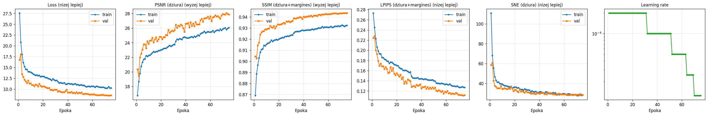
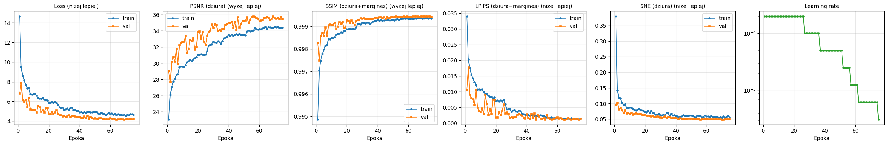
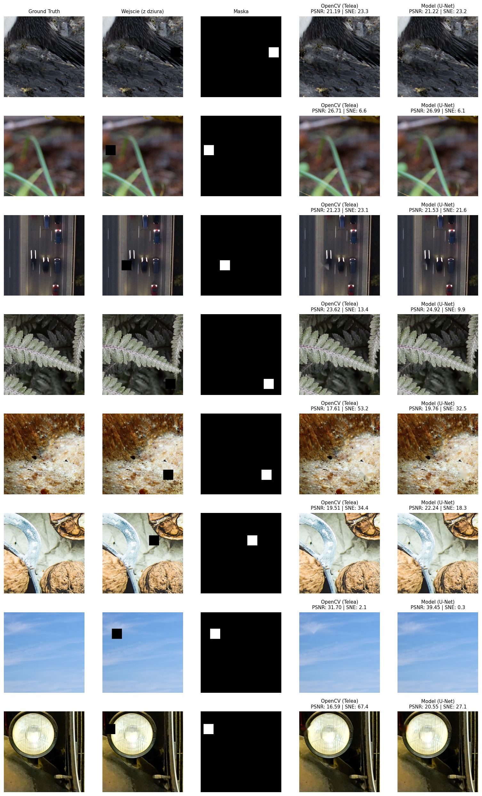
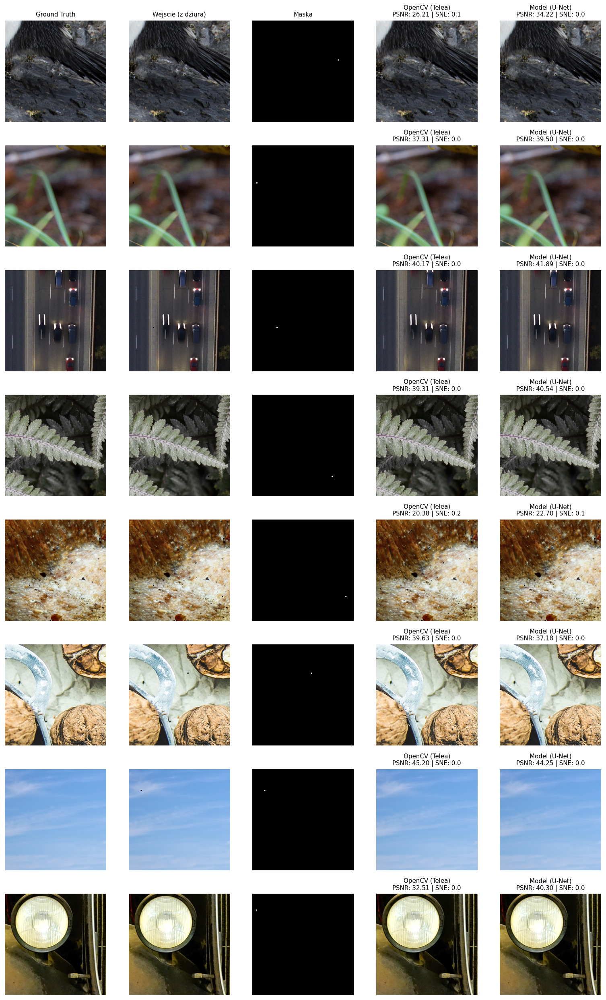

# Inpainting wykorzystaniem konwolucyjnych sieci neuronowych

**Sprawozdanie z projektu 1 - zadanie 2.4: Inpainting**  
**Zbiór danych:** DIV2K  
**Środowisko obliczeniowe:** Python, PyTorch, GPU CUDA (Kaggle)  
**Zakres:** Inpainting obrazów 256x256 z maskami dziur 32x32, 3x3

## Streszczenie

Celem projektu było opracowanie  modelu głębokiego uczenia do wypełniania ubytków (wyzerowanych wartości pixeli) w obrazach (*inpainting*). Rozpatrzono dwie konfiguracje: ubytek o wielkości 32x32 oraz ubytek o wielkości 3x3

W ramach eksperymentu wytrenowano dwa modele opierające się o architekturę **UNet** i porównano je z metodą referencyjną (*baseline*) inpaint z biblioteki OpenCV.  Model **UNet** przyjmuje 4 kanałowe wejście (R, G, B, maska). Wykorzystuje połączenia concat, bottleneck, transponowane konwolucje oraz zwykłe konwolucje.

W obu wariantach najlepsze wyniki we wszytkich metrykach osiągnął model **Unet**. Ponizsze tabelki prezentują wyniki na testowanych metrykach.
Rezultaty pokazują, ze odpowiednio głęboki model wraz z dostatecznie duzym zbiorem treningowym i wysokiej jakosci zdjęciami, pozwala na osiaganie lepszych rezultatow od metod klasycznych.

Eksperymenty przeprowadzono na platformie Kaggle z uzyciem CUDA (T4 GPU)

Moduły python z sufiksem *_inpainting.py* pozwalają na odtworzenie potoku treningowego.
### Maska 32 x 32 

| Metoda | PSNR [dB] ↑ | SSIM ↑ | LPIPS ↓ | L1 ↓ |
|---|---:|---:|---:|---:|
| **OpenCV_Inpaint_32_32** | 24,1154 | 0,9205| 0,1332 | 0,0659|
| **Unet_32_32** | **25,3789** | **0,9282** | **0,1250** | **0,0558** |
*`n=400`, `test`, `checkpoint=val_loss`*

### Maska 3 x 3

| Metoda | PSNR [dB] ↑ | SSIM ↑ | LPIPS ↓ | L1 ↓ |
|---|---:|---:|---:|---:|
| **OpenCV_Inpaint_3_3** | 33,114 | 0,9991| 0,0014| 0,0358 |
| **Unet_3_3** | **34,532** | **0,9994** | **0,0009** | **0,0258** |
*`n=400`, `test`, `checkpoint=val_loss`*

## 2. Zbiór danych i przygotowanie obrazów

### 2.1. Źródło i podział danych

W eksperymencie wykorzystano obrazy ze zbioru **DIV2K**. Obrazy w tym zbiorze mają bardzo duże rozdzielczości i w dodatku róznią się od siebie rozmiarami. Zgodnie ze specyfikacją, jako dane treningowe i testowe wykorzystano obrazy w rozmaierze 256x256. Oby otrzymać taki format, z każdego oryginalnego obrazu DIV2K wycięto po 5 fragmentów rozimaru 256x256. Dzięki temu uzyskano odpowednie rozmiary, bez straty oryginalnej jakości. Do tego celi użyto funkcji RandomCrop z TorchVision.

Dane podzielono na trzy zbiory:

| Podzbiór | Liczba fragmentów 256 x 256 | Pochodzenie |
|---|---:|---|
| Treningowy | 4000 | 800 obrazów z części `DIV2K_train_HR`, po 5 fragmentów |
| Walidacyjny | 100 | 20 oryginalnych obrazów z `DIV2K_valid_HR`, po 5 fragmentów |
| Testowy | 400 | 80 oryginalnych obrazów z `DIV2K_valid_HR`, po 5 fragmentów |

 Zbiór testowy został wydzielony ze zbioru walidacyjnego, gdyż na stronie datasetu DIV2K dostępne były jednie zbiory treningowe i walidacyjne.Podział przeprowadzano na poziomie identyfikatorów oryginalnych zdjęć, a nie pojedynczych fragmentów; wszystkie 5 fragmentów danego zdjęcia trafiały do tego samego podzbioru. Ogranicza to ryzyko przecieku informacji między walidacją a testem. 

### 2.2. Generowanie wejść

Obrazy są wczytywane przy uzyciu metody `PIL.Image.open(img_path).convert("RGB")`. Następnie są skalowane do przedziału [0,1] przy uzyciu `torchvision.transforms.ToTensor()`. Przed normalizacją, w przypadku danych treningowych, dodaje sie pseudolosowe lustrzane odbicie przy uzyciu metody `torchvision.transforms.RandomHorizontalFlip(p=0.5)`.
Maska "dziury" w czasie treningu, upewniwszy się ze nie wychodzi poza obrys obrazu, jest generowana pseudolosowo. W czasie inferencji (walidacja, test) maska jest generowana deterministycznie, zgodnie z indexem obrazka.

### 2.3. Metoda referencyjna

Metodą refencyjną była `cv2.inpaint(.., inpaintRadius=3, flags=cv2.INPAINT_TELEA)`). Metoda referencyjna nie podlega treningowi, słuzy do porównania wyników i jest uruchamiania kazdorazowo dla kazdego obrazu. 

Z uwagi na to, ze wczytywany obraz jest skalowany do przedziału [0,1], a OpenCV wymaga precyzji `uint8`, w trakcie porównania metryk, model obraz modelu bazowego jest składany jak obraz w UNet z uzyciem wzoru:

$$ \text{cv2\_comp} = \text{gt\_img} \odot (1.0 - \text{mask}) + \text{cv2\_comp} \odot \text{mask} $$

Pozwala to lepiej porównać jakoś samego obszaru reprodukowanego. W innych przypadku, metoda OpenCV z powodu konwersji do `obraz oryginalny` -> `float` -> `uint8` -> `float` mogłaby tracić na precyzji.
Na wygenerowanych przykładach nizej natomiast, zapisany jest juz raw output z metody OpenCV.

## 3. Architektury sieci neuronowych

### 3.1. Unet - architektura podstawowa

- ConvBlock: 2*Conv 3x3 + BN + LeakyReLU 0.2
- encoder 4 poziomy base=64 (64-128-256-512), MaxPool2d(2)
- bottleneck 16x16, 512 ch
- decoder ConvTranspose2d + skip concat
wyjście 1x1 + Sigmoid -> RGB [0,1]

### 3.2. Liczba parametrów

14 785 667 (~14,8M)

## 4. Procedura treningu i oceny

### 4.1. Konfiguracja uczenia

| Parametr | Wartość |
|---|---|
| Liczba epok | 75 |
| Batch size | 16 |
| Optymalizator | Adam |
| LR  | **0,0002 (`2e-4`)** |
| Funkcja straty | $$\mathcal{L}=60\,\text{L}1_{hole} + 0,5\,\text{L}1_{valid} + 20\,\text{L}2_{hole} + 0,15\,\text{LPIPS}(comp, GT)$$|
| Walidacja | Co epokę |
| Scheduler | `ReduceLROnPlateau` względem `val_LPIPS`, `factor=0,5`, `patience=4` |
| Losowe ziarno | 42 |
| Urządzenie | CUDA GPU |
| AMP | fp16 na CUDA |
| Checkpoint | min_val_loss |
| Early stopping | brak|

Uczenie realizowano z użyciem optymalizatora Adam. Scheduler zmniejszał współczynnik uczenia przy braku odpowiedniej poprawy wyniku walidacyjnego na metryce LPIPS. Biorac pod uwage krzywe uczenia, warto by sprawdzic, czy model nie miał jeszcze w zapasie potencjału pojemnościowego i zdolnosci do uczenia sie.

### 4.2. Metryki jakości

- **PSNR** (*Peak Signal-to-Noise Ratio*) - miara związana z błędem średniokwadratowym, wyrażona w decybelach: $\mathrm{PSNR}=10\log_{10}(1/\mathrm{MSE})$ dla obrazów znormalizowanych do [0, 1]. **Więcej = lepiej**.
- **SSIM** (*Structural Similarity Index*) - porównuje lokalną strukturę, kontrast i jasność obrazów. **Więcej = lepiej**.
- **LPIPS** (*Learned Perceptual Image Patch Similarity*) - odległość percepcyjna wyznaczana na podstawie reprezentacji sieci `vgg`; wejścia przekształcono do zakresu [-1, 1]. **Mniej = lepiej**.
- **L1 (MAE)** - średni błąd bezwzględny względem obrazu referencyjnego. **Mniej = lepiej**.

Metryki  **PSNR**, **L1 (MAE)** obliczano dla na podstawie roznicy w obszarze ubytku, natomiast **LPIPS** oraz **SSIM** przeliczano dla ubytku z dodatkowym buforem 24px. W czasie treningu widoczne są w logach dodatkowo metryki przeliczane dla całych obrazów, jednak z uwagi na brak reprodukcji poza obszarem ubytku uznano, ze moga one generowac szum w wynikach i nie skupiano się na nich.

### 4.3 Historia treningu
### Maska 32x32

### Maska 3x3

## 5. Wyniki ilościowe
### 5.1 Maska 32 x 32 

| Metoda | PSNR [dB] ↑ | SSIM ↑ | LPIPS ↓ | L1 ↓ |
|---|---:|---:|---:|---:|
| **OpenCV_Inpaint_32_32** | 24,1154 | 0,9205| 0,1332 | 0,0659|
| **Unet_32_32** | **25,3789** | **0,9282** | **0,1250** | **0,0558** |
*`n=400`, `test`, `checkpoint=val_loss`*

### 5.2 Maska 3 x 3

| Metoda | PSNR [dB] ↑ | SSIM ↑ | LPIPS ↓ | L1 ↓ |
|---|---:|---:|---:|---:|
| **OpenCV_Inpaint_3_3** | 33,114 | 0,9991| 0,0014| 0,0358 |
| **Unet_3_3** | **34,532** | **0,9994** | **0,0009** | **0,0258** |
*`n=400`, `test`, `checkpoint=val_loss`*

Dla obu masek, model **UNet** osiągnął lepsze wyniki niz model bazowy OpenCV. Róznice numeryczne/metrykowe są jednak nieznaczne.

### 5.3 UNet vs OpenCV

| | 32x32 | 3x3 |
|---|---|---|
| ΔPSNR | +1,26 | +1,42 |
| ΔSSIM | +0,0077 | +0,0003 |
| ΔLPIPS | -0,0082 | -0,00053 |
| PSNR wyższe | 319/400 (79,8%) | 274/400 (68,5%) |
| SSIM wyższe | 328/400 (82,0%) | 278/400 (69,5%) |
| LPIPS niższe | 272/400 (68,0%) | 279/400 (69,8%) |

### 5.4 Czas

| | Czas [min] |
|---|---|
| U-Net hole 32 | 286,9 (~4,8 h) |
| U-Net hole 3 | 315,8 (~5,3 h) |

## 6. Analiza jakościowa obrazów

*Rys. Obrazy wynikowe dla maski 32x32*

Model **Unet** co do zasady lepsze metryki, ale są one zblizone do modelu OpenCV. Na obrazach testowych widać, 
ze reprodukcje OpenCV co do zasady generują bardziej wyblurowane obrazy, jakoby uśredniajac obraz.
Model **Unet** podobnie generuje obrazu, jednak widac tam swego rodzaju "linie" rozgraniczajace kolejny obszary obszaru reprodukcji. Linie te mogą miec związek z uzycien transponowanych konwolucji. Na innych obrazach (np. kartka papieru pognieciona) mozna odniesc wrazenie, jakoby model **UNet** lepiej zwracał oryginalna teksturę. Metoda OpenCV natomiast lepiej sprawdza sie na jednorodnych obrazach jak np. niebo.

*Rys. Obrazy wynikowe dla maski 3x3*

Dla gołego oka, róznice pomiędzy oboma metodami na tak małym ubytku są de facto pomijalne. 

## 7. Dyskusja/wnioski

Niniejsze zadanie było bardzo ciekawe, ale w tym samym czasie nauczyło pokory. Mozna odniesc wrazenie, ze w tym konkretnym zadaniu uzycie/trenowanie modelu UNet nie ma sensu z uwagi na:
- długi czas trenowania
- wymóg "mocniejszego" sprzętu do treningu/inferencji
- wagę modelu
- znikome rónice w metrykach
- znikome roznice w rzeczywistych reprodukcjach, poza ogólną róznica "stylu" (faktura, linie, usrednianie)

Byc moze warto by sprobowac wytrenowac mniejszy model. Z drugiej strony, prezentowane modele są kolejną iteracją modeli UNet. Dopiero te przedstawione pozwoliły osiągnąć lepsze metryki niz OpenCV. Co tez nie jest do konca prawdziwe, bo rzeczywisty skok jakosciowy w moim rozumieniu przyszedł dopiero po uzyciu danych treningowych wyprodukowanych w ramach augmentacji offline (patrz preprocessing danych). To pokazuje kolejną rzecz, jak bardzo poza mocą obliczeniową, wazne sa odpowiednie (ilościowo i jakościwoo) dane trenigowe.