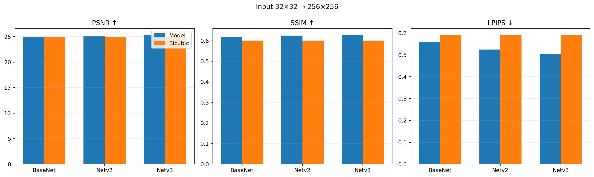
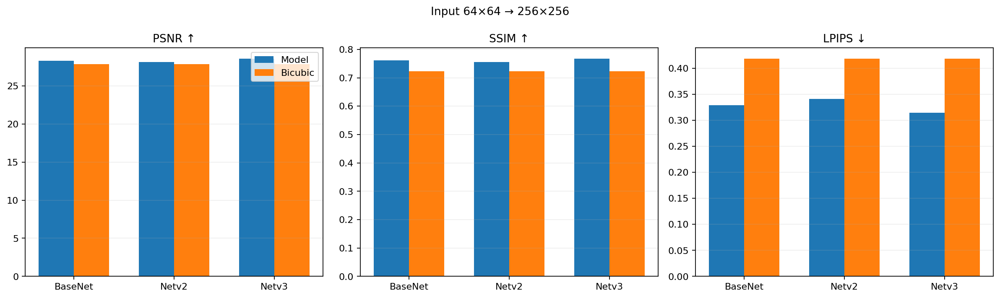
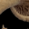
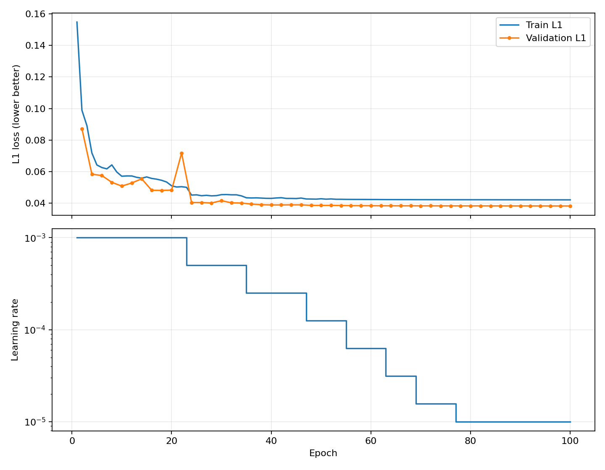
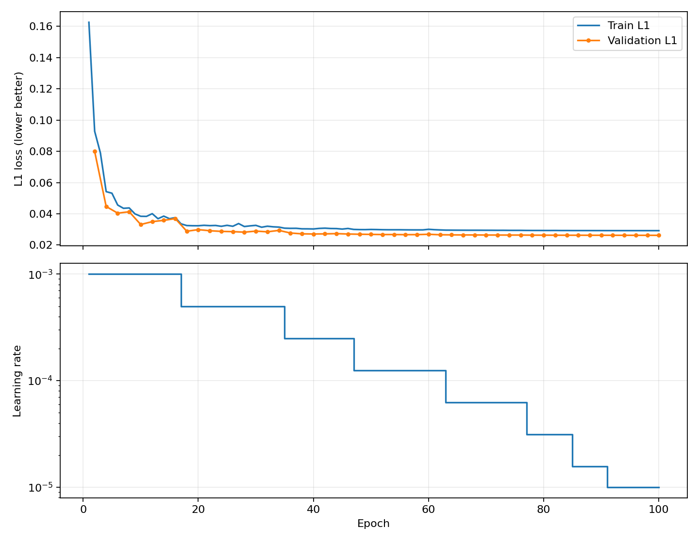
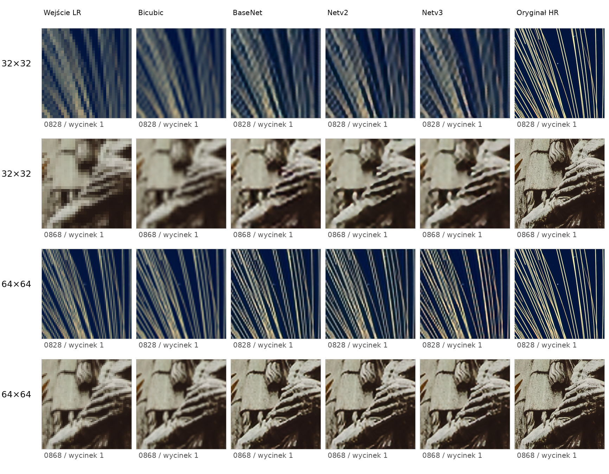
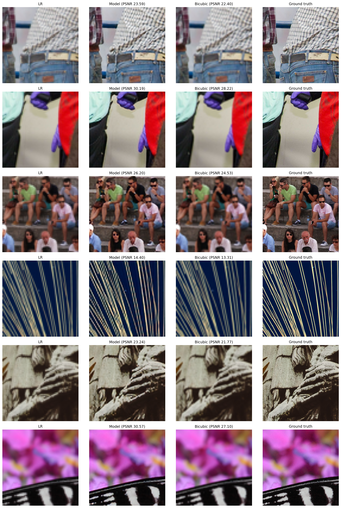
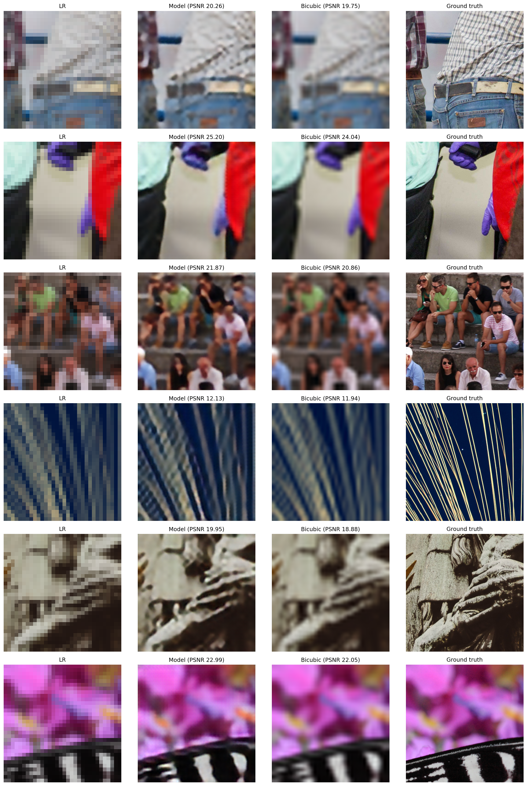

# Zwiększanie rozdzielczości obrazów z wykorzystaniem konwolucyjnych sieci neuronowych

**Sprawozdanie z projektu 1 — zadanie 2.1: Zwiększanie rozdzielczości**  
**Zbiór danych:** DIV2K  
**Środowisko obliczeniowe:** Python, PyTorch, GPU CUDA   
**Zakres:** Rekonstrukcja obrazów 256 × 256 z wejść 32 × 32 i 64 × 64

## Streszczenie

Celem projektu było opracowanie  modeli głębokiego uczenia do zwiększania rozdzielczości obrazów (*single-image super-resolution*). Rozpatrzono dwie konfiguracje: przeskalowanie obrazów z 32 × 32 do 256 × 256 (skala ×8) oraz z 64 × 64 do 256 × 256 (skala ×4). 

W ramach eksperymentu, porównano trzy architektury sieci konwolucjnych o roboczych nazwach: **BaseNet**, **Netv2** oraz **Netv3**. Metodą referencyjną (*baseline*) była interpolacja bikubiczna z biblioteki OpenCV.

Modele trenowane były w takiej samej konfiguracji treningowej (liczba epok, stała uczenia, optymizator itp.). W obu wartiantach wejścia metody oparte o sieci głebokie przewyższały interpolacje bikubiczną. W obu wariantach najlepsze wyniki we wszytkich metrykach osiągnął motel **Netv3** wykorzystujcy operajce PixelShuffle oraz rezydualne połączenia (*residual connections*). Dla wejścia 32 × 32 uzyskał PSNR **25,366 dB**, SSIM **0,6285** i LPIPS **0,5032**, w porównaniu z odpowiednio **24,956 dB**, **0,6002** i **0,5919** dla interpolacji bikubicznej. Dla wejścia 64 × 64 wartości wyniosły odpowiednio **28,559 dB**, **0,7674**, **0,3140**, wobec **27,844 dB**, **0,7235**, **0,4183** dla metody referencyjnej. Rezultaty wskazują, że uczenie reprezentacji obrazu może poprawiać zarówno zgodność pikselową i strukturalną, jak i podobieństwo percepcyjne, przy czym większe zwiększanie skali pozostaje trudniejsze.

### Wejście 32 × 32 — zwiększenie rozdzielczości ×8

| Metoda | PSNR [dB] ↑ | SSIM ↑ | LPIPS ↓ | L1 ↓ |
|---|---:|---:|---:|---:|
| **OpenCV bicubic (32 → 256)** | 24,956 | 0,6002 | 0,5919 | 0,04847 |
| BaseNet ×8 | 24,991 | 0,6187 | 0,5584 | 0,04558 |
| Netv2 ×8 | 25,165 | 0,6250 | 0,5251 | 0,04491 |
| **Netv3 ×8** | **25,366** | **0,6285** | **0,5032** | **0,04395** |

### 5.2. Wejście 64 × 64 — zwiększenie rozdzielczości ×4

| Metoda | PSNR [dB] ↑ | SSIM ↑ | LPIPS ↓ | L1 ↓ |
|---|---:|---:|---:|---:|
| **OpenCV bicubic (64 → 256)** | 27,844 | 0,7235 | 0,4183 | 0,03401 |
| BaseNet ×4 | 28,290 | 0,7607 | 0,3287 | 0,03103 |
| Netv2 ×4 | 28,102 | 0,7554 | 0,3406 | 0,03178 |
| **Netv3 ×4** | **28,559** | **0,7674** | **0,3140** | **0,03028** |

## 2. Zbiór danych i przygotowanie obrazów

### 2.1. Źródło i podział danych

W eksperymencie wykorzystano obrazy ze zbioru **DIV2K**. Obrazy w tym zbiorze mają bardzo duże rozdzielczości i w dodatku róznią się od siebie rozmiarami. Zgodnie ze specyfikacją, jako dane treningowe i testowe wykorzystano obrazy w rozmaierze 256x256. Oby otrzymać taki format, z każdego oryginalnego obrazu DIV2K wycięto po 3 fragmenty rozimaru 256x256. Dzięki temu uzyskano odpowednie rozmiary, bez straty oryginalnej jakości. Do tego celi użyto funkcji RandomCrop z TorchVision.

Dane podzielono na trzy zbiory:

| Podzbiór | Liczba fragmentów 256 × 256 | Pochodzenie |
|---|---:|---|
| Treningowy | 2400 | 800 obrazów z części `DIV2K_train_HR`, po 3 fragmenty |
| Walidacyjny | 60 | 20 oryginalnych obrazów z `DIV2K_valid_HR`, po 3 fragmenty |
| Testowy | 240 | 80 oryginalnych obrazów z `DIV2K_valid_HR`, po 3 fragmenty |

 Zbiór testowy został wydzielony ze zbioru walidacyjnego, gdyż na stronie datasetu DIV2K dostępne były jednie zbiory treningowe i walidacyjne.Podział przeprowadzano na poziomie identyfikatorów oryginalnych zdjęć, a nie pojedynczych fragmentów; wszystkie trzy fragmenty danego zdjęcia trafiały do tego samego podzbioru. Ogranicza to ryzyko przecieku informacji między walidacją a testem. 

### 2.2. Generowanie wejść o niskiej rozdzielczości

Obrazy referencyjne 256 × 256 zmniejszano do 32 × 32 albo 64 × 64. Do tego celu użytko  `torchvision.transforms.v2.Resize(size=(target_size, target_size))`. Metoda ta korzysta z interpolacji biliniowej z antyaliasiniem. 

Obrazy odczytywano w formacie png i normalizowano do przedziału [0, 1].

### 2.3. Metoda referencyjna

Metodą refencyjną była **interpolacja bikubiczna OpenCV** (`cv2.INTER_CUBIC`), Metoda referencyjna nie podlega treningowi; korzysta wyłącznie z deterministycznej interpolacji.

## 3. Architektury sieci neuronowych

Przeprowadzono sześć niezależnych uruchomień: trzy architektury dla każdej rozdzielczości wejściowej. Wszystkie modele przyjmują obraz trójkanałowy, wykonują ekstrakcję cech, a następnie stopniowo zwiększają rozdzielczość. Liczba etapów skalowania w góre (*upscaling*) ×2 wynosi **3 dla wejścia 32 × 32** oraz **2 dla wejścia 64 × 64**.

### 3.1. BaseNet — architektura podstawowa

`BaseNet` wykorzystuje trzy warstwy konwolucyjne 3 × 3 (`3 → 32 → 32 → 32` kanałów) z aktywacjami ReLU. Zwiększanie rozdzielczości realizują warstwy konwolucji transponowanej (dekonwolucji) `ConvTranspose2d` o jądrze 4 × 4, kroku 2 i `padding=1`. Ostatnia warstwa 3 × 3 rzutuje 32 mapy cech na trzy kanały RGB. Model stanowi punkt odniesienia dla bardziej rozbudowanych architektur neuronowych.

### 3.2. Netv2 — dodatkowa rekonstrukcja cech

`Netv2` zachowuje początkowy ekstraktor i konwolucje transponowane, lecz po **każdym** etapie powiększania dodaje konwolucję 3 × 3 (`32 → 32`) z aktywacją ReLU. Zwiększa to zdolność do przetwarzania cech na kolejnych poziomach rozdzielczości, kosztem większej liczby parametrów i operacji.

### 3.3. Netv3 — bloki rezydualne i PixelShuffle

`Netv3` po początkowym ekstraktorze stosuje **trzy bloki rezydualne**, z których każdy zawiera dwie konwolucje 3 × 3. Wynik drugiej konwolucji dodaje się do wejścia bloku, co ułatwia propagację informacji i uczenie korekt reprezentacji. Zamiast konwolucji transponowanych do zwiększania rozdzielczości stosowane są etapy `Conv2d(32, 128, 3 × 3) → PixelShuffle(2) → ReLU`. `PixelShuffle` reorganizuje kanały w dwukrotnie większe wymiary przestrzenne. Na końcu warstwa 3 × 3 generuje obraz RGB.

### 3.4. Liczba parametrów

| Architektura | 32 × 32 → 256 × 256 (×8) | 64 × 64 → 256 × 256 (×4) |
|---|---:|---:|
| BaseNet | 69 507 | 53 091 |
| Netv2 | 97 251 | 71 587 |
| Netv3 | 186 723 | 149 731 |

## 4. Procedura treningu i oceny

### 4.1. Konfiguracja uczenia

| Parametr | Wartość |
|---|---|
| Liczba epok | 100 |
| Batch size | 32 |
| Optymalizator | Adam |
| LR  | **0,001 (`1e-3`)** |
| Funkcja straty | L1 / MAE |
| Walidacja | Co 2 epoki, dodatkowo w końcowej epoce |
| Scheduler | `ReduceLROnPlateau`, `factor=0,5`, `patience=2` |
| Threshold | 0,003 |
| Minimalny learning rate | `1e-5` |
| Losowe ziarno | 42 |
| Urządzenie | CUDA GPU |
| Wybór modelu do testu | Checkpoint o najmniejszej walidacyjnej stracie L1 |
| Early stopping | po 5 epokach bez poprawy |

Funkcja kosztu L1 mierzy średnią bezwzględną różnicę pomiędzy przewidywanym i referencyjnym pikselem:

$$
\mathcal{L}_{L1}=\frac{1}{3HW}\sum_{c=1}^{3}\sum_{i=1}^{H}\sum_{j=1}^{W}|\hat I_{cij}-I_{cij}|.
$$

Uczenie realizowano z użyciem optymalizatora Adam. Scheduler zmniejszał współczynnik uczenia przy braku odpowiedniej poprawy wyniku walidacyjnego. Kod zawiera także mechanizm wcześniejszego zakończenia po pięciu kolejnych walidacjach bez poprawy, ale **wszystkie sześć zapisanych przebiegów osiągnęło 100 epok**; najlepsze checkpointy również pochodzą z epoki 100. Wskazuje to na to, że modele mogły potencjalnie być uczone dłuzej i osiągnąc lepsze wyniki.

### 4.2. Metryki jakości

 Dla każdej próbki oceniano sieć i interpolację bikubiczną względem tego samego obrazu HR; następnie uśredniano wartości **po 240 obrazach testowych**.

- **PSNR** (*Peak Signal-to-Noise Ratio*) — miara związana z błędem średniokwadratowym, wyrażona w decybelach: $\mathrm{PSNR}=10\log_{10}(1/\mathrm{MSE})$ dla obrazów znormalizowanych do [0, 1]. **Więcej = lepiej**.
- **SSIM** (*Structural Similarity Index*) — porównuje lokalną strukturę, kontrast i jasność obrazów; w eksperymencie użyto obliczeń dla RGB z wagami gaussowskimi o $\sigma=1{,}5$. **Więcej = lepiej**.
- **LPIPS** (*Learned Perceptual Image Patch Similarity*) — odległość percepcyjna wyznaczana na podstawie reprezentacji sieci `alex`; wejścia przekształcono do zakresu [−1, 1]. **Mniej = lepiej**.
- **L1 (MAE)** — średni błąd bezwzględny względem obrazu referencyjnego. Wprawdzie nie należy do trzech metryk wymaganych w tabeli końcowej, ale został obliczony w notebooku i stanowi dodatkową miarę jakości. **Mniej = lepiej**.

PSNR liczono osobno dla każdej próbki i dopiero później uśredniano. Dlatego raportowane średnie PSNR **nie są równe** PSNR wyznaczonemu z jednego MSE zagregowanego po całym zbiorze. Zapisane odchylenia standardowe w wynikach odnoszą się do wyników pojedynczych fragmentów, a nie do powtórzeń treningu.

## 5. Wyniki ilościowe

### 5.1. Wejście 32 × 32 — zwiększenie rozdzielczości ×8

| Metoda | PSNR [dB] ↑ | SSIM ↑ | LPIPS ↓ | L1 ↓ |
|---|---:|---:|---:|---:|
| **OpenCV bicubic (32 → 256)** | 24,956 | 0,6002 | 0,5919 | 0,04847 |
| BaseNet ×8 | 24,991 | 0,6187 | 0,5584 | 0,04558 |
| Netv2 ×8 | 25,165 | 0,6250 | 0,5251 | 0,04491 |
| **Netv3 ×8** | **25,366** | **0,6285** | **0,5032** | **0,04395** |

*Tabela 1. Średnie wyniki dla 240 fragmentów testowych o referencyjnej rozdzielczości 256 × 256. Strzałki wskazują kierunek pożądanej poprawy.*

Dla wariantu 32x32 wszystkie trzy sieci poprawiły względem interpolacji bikubicznej średnie wyniki PSNR, SSIM, LPIPS i L1. Najlepszy `Netv3` zwiększył PSNR o **0,411 dB**, SSIM o **0,0283** oraz zmniejszył LPIPS o **0,0887** (około **15%**) i L1 o **0,00452** (około **9%**).

*Rysunek 1. PSNR, SSIM i LPIPS w konfiguracji ×8*

### 5.2. Wejście 64 × 64 — zwiększenie rozdzielczości ×4

| Metoda | PSNR [dB] ↑ | SSIM ↑ | LPIPS ↓ | L1 ↓ |
|---|---:|---:|---:|---:|
| **OpenCV bicubic (64 → 256)** | 27,844 | 0,7235 | 0,4183 | 0,03401 |
| BaseNet ×4 | 28,290 | 0,7607 | 0,3287 | 0,03103 |
| Netv2 ×4 | 28,102 | 0,7554 | 0,3406 | 0,03178 |
| **Netv3 ×4** | **28,559** | **0,7674** | **0,3140** | **0,03028** |

*Tabela 2. Średnie wyniki dla 240 fragmentów testowych w konfiguracji ×4.*

Dla wejścia 64 × 64 sieci również osiągnęły wyniki korzystniejsze od metody referencyjnej. `Netv3` zwiększył średni PSNR o **0,715 dB**, SSIM o **0,0439** i obniżył LPIPS o **0,1043** (około **24,9%**) oraz L1 o **0,00373** (około **11,0%**). Co istotne, `BaseNet` okazał się w tym wariancie lepszy niż `Netv2`, mimo mniejszej liczby parametrów.

*Rysunek 2. PSNR, SSIM i LPIPS w konfiguracji ×4*

### 5.3. Netv3 (najlepszy model) vs bicubic (baseline)

| Różnica: Netv3 − bicubic | Wejście 32 × 32 | Wejście 64 × 64 |
|---|---:|---:|
| ΔPSNR [dB] | +0,411 | +0,715 |
| ΔSSIM | +0,0283 | +0,0439 |
| ΔLPIPS | −0,0887 | −0,1043 |
| ΔL1 | −0,00452 | −0,00373 |
| Próbki z lepszym PSNR | 216 / 240 (90,0%) | 217 / 240 (90,4%) |
| Próbki z lepszym SSIM | 205 / 240 (85,4%) | 213 / 240 (88,8%) |
| Próbki z niższym LPIPS | 227 / 240 (94,6%) | 231 / 240 (96,3%) |

*Tabela 3. Zmiany średnich metryk oraz analiza parowana poszczególnych próbek.Dodatni ΔPSNR/ΔSSIM oraz ujemny ΔLPIPS/ΔL1 oznaczają poprawę.*
 
Model `Netv3` jest istotnie lepszy, ale istnieją obrazy dla których bicubic byó lepsze. Przykładem są niemal jednolite wycinki obrazu `0839` — dla fragmentu `0839_crop_x256_0` interpolacja bikubiczna osiąga około **89,306 dB**, podczas gdy `Netv3` otrzymuje **55,666 dB** (wejście ×8) lub **49,829 dB** (wejście ×4). Ten wycinek wygląda tak: 

Na tak prostych obrazach interpolacja może niemal idealnie odtworzyć HR, natomiast niewielki błąd generowany przez sieć silnie obniża PSNR.

### 5.4. Koszt obliczeniowy i przebieg uczenia

| Architektura | Czas treningu ×8 [min] | Czas treningu ×4 [min] |
|---|---:|---:|
| BaseNet | 13,51 | 13,91 | 
| Netv2 | 22,49 | 22,34 | 
| Netv3 | 15,77 | 17,00 | 

*Tabela 4. Czas trenowania poszczególnych modeli. Czasy dotyczą konkretnych uruchomień w środowisku CUDA.

Na obu rozdzielczościach `Netv3` uzyskał najmniejszy błąd walidacyjny L1. Można przypuszczać, że niektóre modele mogłby być uczone dalej, jednak krzywe uczenia nie wskazują na to jednoznacznie

*Rysunek 4. Strata treningowa i walidacyjna oraz zmiany learning rate dla Netv3 w zadaniu ×8.*

*Rysunek 4. Strata treningowa i walidacyjna oraz zmiany learning rate dla Netv3 w zadaniu ×4.*

Nie obserwuje się prostej zależności „więcej parametrów = dłuższy czas”: mimo najwyższej liczby parametrów `Netv3` trenował się szybciej od `Netv2`. Można to wiązać z różnicami w charakterystyce operacji, ale bez profilowania jądra GPU i przepływu danych nie da się jednoznacznie wskazać przyczyny.

## 6. Analiza jakościowa obrazów

Zestawienie poniżej pokazuje dwa przykładowe fragmenty obrazów o identyfikatorach `0828` i `0868`, wspólne dla obu rozdzielczości wejściowych. Obraz LR w pierwszej kolumnie powiększono metodą najbliższego sąsiada **wyłącznie na potrzeby prezentacji jego pikselizacji**. Pozostałe kolumny pokazują rzeczywiste wyniki interpolacji bikubicznej i trzech modeli oraz oryginał HR.

*Rysunek 6. Porównanie jakości rekonstrukcji: wejście LR (wizualizacja nearest-neighbor), bicubic, BaseNet, Netv2, Netv3 i obraz referencyjny; próbki z wyników testowych udostępnionych w archiwum.*

Na przedstawionych przykładach dostrzegalne są następujące zależności:

1. Patrząc na obrazy ludzkik okiem wydaję się, że sieci neuronowe generują obrazy przynajmniej tak samo dobre, a często lepsze, niż metoda `bicubic`. Pomimo tego, każda z metod generuje wyraźnie gorsze obrazy od oryginalnych.

2. Obrazy generowane metodą `bicubic` są mocno wygładzone i rozmyte, podczas gdy obrazy generowane prez sieci mają wiecej ostrych szczegółów.

3. Wariant wejścia 32x32 jest zdecydowanie trudniejszy zarówno dla bicubic jak i sieci neuronowych. Odwtorzenie szczegółow z tak małego obrazu wydaje się być trudne. 

Poniżej jeszcze pełniejsze porównanie wyników najlepszego modelu Netv3 oraz bicubic:

*Rysunek 6. Porównanie jakości rekonstrukcji dla obrazów x64 - Netv3 vs. bicubic.

*Rysunek 7. Porównanie jakości rekonstrukcji dla obrazów x32 - Netv3 vs. bicubic.

